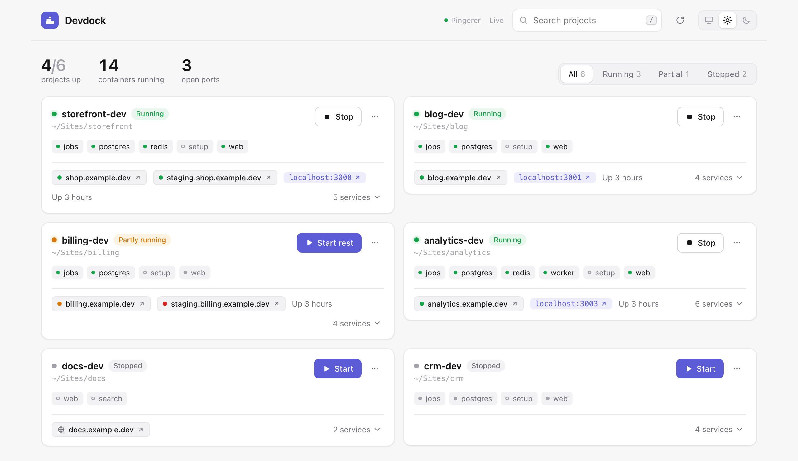

# Devdock

[](https://github.com/BasharLulu/devdock/actions/workflows/ci.yml)

A tiny local dashboard for starting and stopping Docker Compose dev projects.

Devdock scans `~/Sites` for compose projects and gives you one page to see what's running, start/stop/restart/rebuild whole projects or single services, open their published ports, and tail logs.

<picture>
  <source media="(prefers-color-scheme: dark)" srcset="docs/screenshot-dark.png">
  
</picture>

No dependencies, no build step: a Node server (`server.mjs`) that shells out to `docker compose`, and a single static page (`index.html`).

## Requirements

- Node 18+
- Docker Desktop (the `docker` CLI at `/usr/local/bin/docker` or `/opt/homebrew/bin/docker`, or on `PATH`)

## Run

```bash
node server.mjs
```

Then open http://127.0.0.1:7777.

## Testing

```bash
node test/smoke.mjs
```

Starts the server on port 7799 against a throwaway compose project (a `busybox` container) and checks discovery, the localhost guards, start/stop/down and logs. Needs Docker. CI runs it on Node 18, 20, 22 and 24.

## Configuration

| Env var        | Default    | Description                                        |
| -------------- | ---------- | -------------------------------------------------- |
| `PORT`         | `7777`     | Port to listen on (always bound to `127.0.0.1`)    |
| `DEVDOCK_DIRS` | `~/Sites`  | Colon-separated list of directories to scan        |
| `DEVDOCK_CONFIG` | `~/.config/devdock/config.json` | Path to the optional [config file](#config-file) |

## Deployed site links

Each card shows links to where the project is deployed, next to its `localhost` ports.

Links are read from [Kamal](https://kamal-deploy.org) deploy configs in the project: `proxy.host` / `proxy.hosts` in `config/deploy.yml` (labelled *production*) and in each `config/deploy.<destination>.yml` (labelled with the destination name, e.g. *staging*). Wildcards, IP addresses, ERB/env interpolation and template placeholders like `app.example.com` are skipped. Links always use `https://`.

To add links Devdock can't detect, rename them, or turn detection off for a project, use the [config file](#config-file).

### Site status from Pingerer

If you use [Pingerer](https://pingerer.com) for uptime monitoring, Devdock can show each site's status as a dot on its link: green (up), amber (degraded), red (down) or grey (pending/paused). Sites Pingerer doesn't monitor keep a plain globe icon.

1. Create a **read-only** API token at https://pingerer.com/api_tokens.
2. Add it to the config file under `pingerer.token`.

Devdock fetches `GET /api/v1/sites` at most once a minute, only while the dashboard is open, and matches sites to links by hostname. The token stays on the server and is never sent to the browser. Without a token, Devdock never contacts Pingerer.

## Config file

Optional. Devdock reads `~/.config/devdock/config.json` (or the path in `DEVDOCK_CONFIG`) and picks up changes without a restart.

```json
{
  "pingerer": {
    "token": "YOUR_READ_ONLY_TOKEN",
    "accounts": ["acct_123", "acct_456"]
  },
  "projects": {
    "myapp-dev": {
      "links": [
        { "label": "production", "url": "https://myapp.com" },
        { "label": "admin", "url": "https://admin.myapp.com" }
      ]
    },
    "other-dev": { "detect": false, "links": [{ "label": "site", "url": "https://other.example.org" }] }
  }
}
```

| Key | Description |
| --- | --- |
| `pingerer.token` | Pingerer API token. Read-only is enough. |
| `pingerer.accounts` | Optional Pingerer account IDs to query (sent as the `Pingerer-Account` header). Defaults to the token's account. |
| `pingerer.url` | Optional, defaults to `https://pingerer.com`. |
| `projects.<name>.links` | Extra links for a compose project, by its project name. A link with the same host as a detected one replaces it. Only `http`/`https` URLs are accepted. |
| `projects.<name>.detect` | Set to `false` to ignore Kamal configs for that project. |

The file can hold a token, so keep it private:

```bash
chmod 600 ~/.config/devdock/config.json
```

## How projects are found

Projects come from two sources, merged by compose project name:

1. **Scanned folders** — every immediate subfolder of `DEVDOCK_DIRS` containing `docker-compose.dev.yml`, `docker-compose.dev.yaml`, `compose.dev.yml` or `compose.dev.yaml`. The project name is the file's top-level `name:`, or `<folder>-dev` if it has none. These show up even before any containers exist.
2. **`docker compose ls -a`** — any other compose project Docker already knows about. Config files inside `.claude/worktrees/` or `copilot-worktrees/` are skipped in favour of the main checkout.

## What the buttons do

| Button  | Command                                   |
| ------- | ----------------------------------------- |
| Start   | `docker compose up -d [service]`          |
| Stop    | `docker compose stop [service]`           |
| Restart | `docker compose restart [service]`        |
| Rebuild | `docker compose up -d --build`            |
| Down    | `docker compose down --remove-orphans` (volumes are kept) |
| Logs    | `docker compose logs --tail 300 [service]` |

Every command runs with `-f <config> -p <project>` from the project's directory. One action per project runs at a time; its output streams into the "Output" panel.

Status dots: **green** — all long-running services up, **amber** — some up (e.g. `web` exited but `postgres` running), **grey** — stopped. One-shot services that exited with code 0 (like `setup`) don't count as down.

## Auto-start on login (macOS)

Create `~/Library/LaunchAgents/local.devdock.plist`:

```xml
<?xml version="1.0" encoding="UTF-8"?>
<!DOCTYPE plist PUBLIC "-//Apple//DTD PLIST 1.0//EN" "http://www.apple.com/DTDs/PropertyList-1.0.dtd">
<plist version="1.0">
<dict>
  <key>Label</key>
  <string>local.devdock</string>
  <key>ProgramArguments</key>
  <array>
    <string>/Users/YOUR_USER/.local/bin/mise</string>
    <string>x</string>
    <string>node</string>
    <string>--</string>
    <string>node</string>
    <string>/Users/YOUR_USER/Sites/devdock/server.mjs</string>
  </array>
  <key>WorkingDirectory</key>
  <string>/Users/YOUR_USER/Sites/devdock</string>
  <key>EnvironmentVariables</key>
  <dict>
    <key>PATH</key>
    <string>/usr/local/bin:/opt/homebrew/bin:/usr/bin:/bin:/usr/sbin:/sbin</string>
  </dict>
  <key>RunAtLoad</key>
  <true/>
  <key>KeepAlive</key>
  <true/>
  <key>ThrottleInterval</key>
  <integer>10</integer>
  <key>StandardOutPath</key>
  <string>/Users/YOUR_USER/Library/Logs/devdock.log</string>
  <key>StandardErrorPath</key>
  <string>/Users/YOUR_USER/Library/Logs/devdock.log</string>
</dict>
</plist>
```

Replace `YOUR_USER` with your macOS username (`whoami`). Node is launched through [mise](https://mise.jdx.dev) so the agent survives Node upgrades; if you don't use mise, replace the first five arguments with the full path to `node` (`which node`).

Load it:

```bash
launchctl bootstrap gui/$(id -u) ~/Library/LaunchAgents/local.devdock.plist
```

Restart after editing the code:

```bash
launchctl kickstart -k gui/$(id -u)/local.devdock
```

Remove:

```bash
launchctl bootout gui/$(id -u)/local.devdock && rm ~/Library/LaunchAgents/local.devdock.plist
```

Logs go to `~/Library/Logs/devdock.log`.

## Security

Devdock can start and stop containers, so it is locked to your machine:

- Listens on `127.0.0.1` only.
- Rejects requests whose `Host` isn't `127.0.0.1`/`localhost` (blocks DNS rebinding) and cross-origin `POST`s.
- Only contacts the internet if you configure a Pingerer token, and then only Pingerer's API. The token never reaches the browser.
- Only runs commands for projects it discovered, with a fixed set of actions and validated service names; arguments are passed to `docker` directly, never through a shell.

There is no authentication — don't expose the port.

To report a vulnerability, see [SECURITY.md](SECURITY.md).

## License

[MIT](LICENSE)
